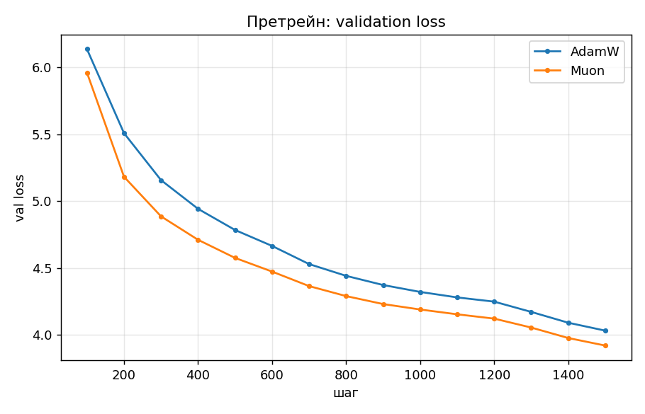
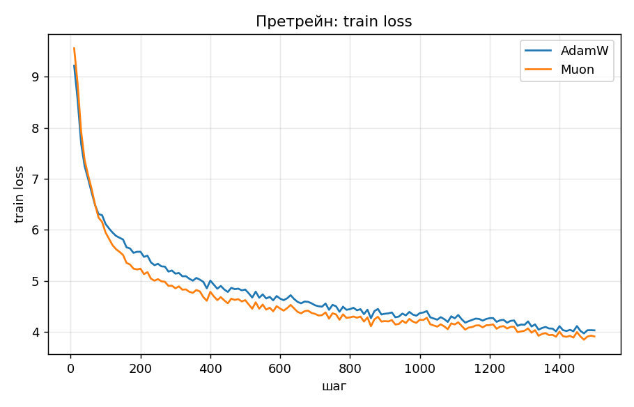
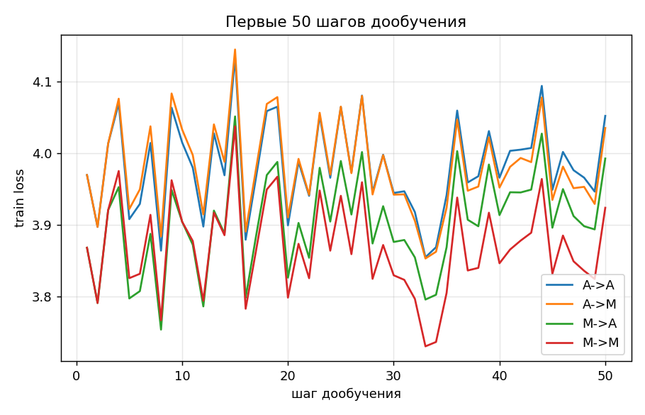
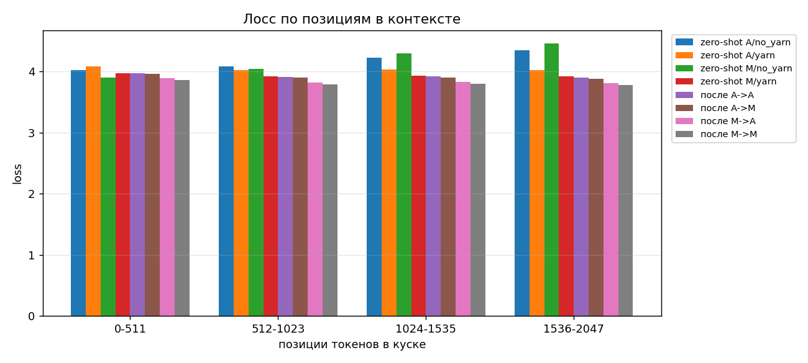
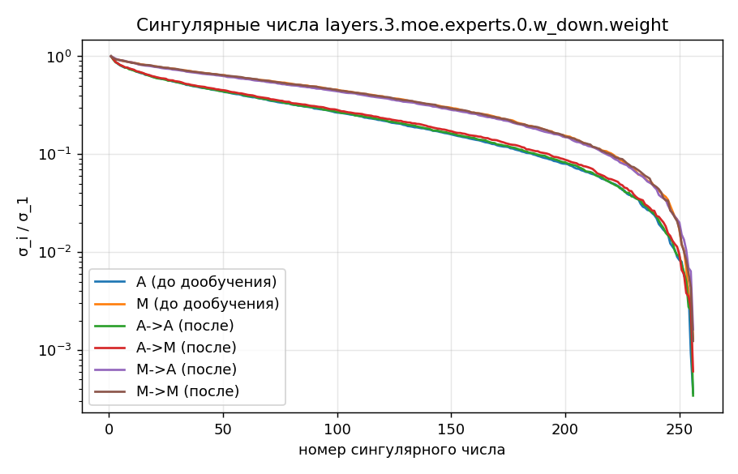
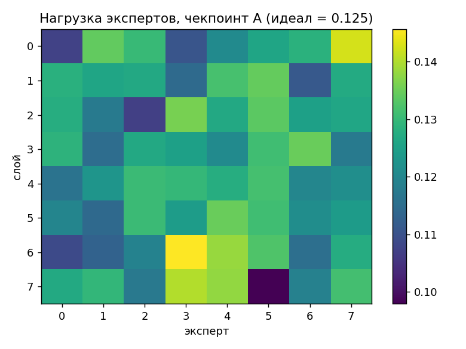
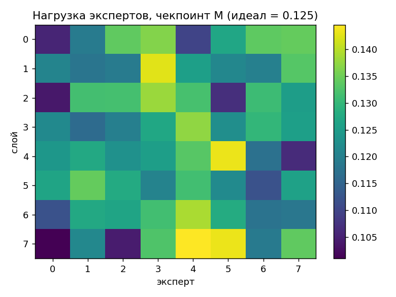

# Kestrel-22M-A4M: технический отчёт

> **Как с этим работать.** Это почти готовый отчёт о маленькой языковой модели Kestrel. Почти, потому что в нём не хватает куска кода и части чисел. Код допишете вы, в проекте `kestrel-hw`: пять файлов, каждый разобран в приложении A. Числа либо посчитаете руками, либо возьмёте из своих прогонов в Colab. Всё, что надо заполнить, помечено **[ЗАПОЛНИТЬ]**, а раздел 8 целиком ваш.
>
> На всё про всё закладывайте 15–20 часов. Претрейн мы уже прогнали и выложили два готовых чекпоинта, так что на вашей стороне остаются четыре дообучения: 40–60 минут на GPU. Сдать нужно архив с проектом (`kestrel-hw.zip`), `results.json` из ноутбука и этот отчёт с заполненными пропусками (приложение B). Числа в отчёте должны совпадать с тем, что записал ноутбук; мы это проверяем скриптом. LLM пользоваться можно, но за свой код и за свои выводы отвечаете вы.
>
> **Что надо написать в коде** (в каждом файле есть функции с `raise NotImplementedError`; docstring описывает только интерфейс, а формулы и алгоритм живут в этом отчёте):
>
> | Файл | Что реализовать | Где описано |
> | --- | --- | --- |
> | [`kestrel/model/yarn.py`](kestrel/model/yarn.py) | `yarn_inv_freq`, `yarn_mscale` | раздел 2.3, приложение A.1 |
> | [`kestrel/model/attention.py`](kestrel/model/attention.py) | `expand_kv`, `GQAttention.forward` | раздел 2.2, приложение A.2 |
> | [`kestrel/model/moe.py`](kestrel/model/moe.py) | `route`, `switch_aux_loss`, `MoE.forward` | раздел 2.4, приложение A.3 |
> | [`kestrel/optim/adamw.py`](kestrel/optim/adamw.py) | `AdamW.step` | раздел 4.1, приложение A.4 |
> | [`kestrel/optim/param_groups.py`](kestrel/optim/param_groups.py) | `split_params` | раздел 4.1 (таблица 3), приложение A.5 |

## Аннотация

Kestrel-22M-A4M это decoder-only модель со смесью экспертов: 22.3 млн параметров, из которых на каждый токен в блоках работает около 4.5 млн. Устроена она из привычных сейчас деталей: grouped-query attention с QK-нормализацией, RoPE, Pre-RMSNorm и восемь SwiGLU-экспертов с top-2 роутингом. Обучать её можно на одной потребительской видеокарте. Вопрос, ради которого всё затевалось, вполне практический: если модель предобучена одним оптимизатором, обязательно ли дообучать её на длинном контексте тем же? Мы взяли два чекпоинта, AdamW и Muon, из одной инициализации и на одних и тех же данных, и выкладываем их вместе с отчётом. Каждый из них растягивается с 512 до 2048 токенов через YaRN и дообучается обоими оптимизаторами. Четыре получившиеся модели сравниваем по лоссу, по поведению на дальних позициях и по тому, что стало со спектром весов.

## 1. Введение

Kestrel учебная, но игрушкой быть не должна. Нам нужна была модель, в которой есть то же, что и в нормальных открытых LLM: grouped-query attention, QK-Norm, RoPE с расширением контекста, смесь экспертов вместо плотного FFN. И чтобы всё это помещалось на одну карту. Ничего нового в этих деталях нет. Интересно другое: как они ведут себя вместе в масштабе, где каждую можно потрогать руками и при желании сломать.

Отдельно нас занимал оптимизатор. За последний год Muon из блог-постов перебрался в отчёты о больших моделях (Moonlight, Kimi K2, DeepSeek-V4), а инструменты для дообучения по-прежнему заточены под AdamW. Отсюда вопрос, на который у нас не было уверенного ответа: можно ли дообучать модель другим оптимизатором, чем тот, которым её предобучали, и что при этом происходит с весами. Шаг Muon имеет плоский спектр, шаг AdamW покоординатный, так что есть основания думать, что смена оптимизатора не пройдёт бесследно.

В разделах 2–4 и в приложении A мы описываем архитектуру и обучение настолько подробно, насколько нужно, чтобы Kestrel можно было воспроизвести. В разделе 5 считаем размер модели, память и вычислительный бюджет. Разделы 6–8 про сам эксперимент $2 	imes 2$ на стадии расширения контекста. Претрейн самая долгая часть, и она одинакова для всех, поэтому чекпоинты A и M мы обучили сами. Ваш эксперимент начинается с них.

## 2. Архитектура

### 2.1. Общая схема

Kestrel собран из восьми одинаковых блоков. В каждом сначала RMSNorm и внимание, потом ещё одна RMSNorm и слой экспертов, и оба подслоя обёрнуты остаточной связью:

$$
\begin{aligned}
h &= x + \mathrm{Attn}\big(\mathrm{RMSNorm}(x)\big),\\
y &= h + \mathrm{MoE}\big(\mathrm{RMSNorm}(h)\big).
\end{aligned}
$$

После последнего блока стоят финальная RMSNorm и LM head. Таблица эмбеддингов и LM head не связаны. Bias нет ни в одном линейном слое.

| Параметр | Обозначение | Значение |
| --- | --- | --- |
| Размер словаря | $V$ | 16 384 |
| Ширина модели | $D$ | 256 |
| Число блоков | $L$ | 8 |
| Головы запросов / KV-головы | $H$ / $H_{kv}$ | 8 / 2 |
| Размер головы | $D_h$ | 32 |
| Эксперты / активных на токен | $E$ / $k$ | 8 / 2 |
| Ширина эксперта | $d_{ff}$ | 256 |
| База RoPE | $b$ | 10 000 |
| $\varepsilon$ в RMSNorm | $\varepsilon$ | $10^{-6}$ |

*Таблица 1. Конфигурация Kestrel-22M-A4M.*

### 2.2. Внимание

Внимание у нас grouped-query: восемь голов запросов делят между собой две пары ключей и значений, по четыре головы на пару. Размер группы $g = H / H_{kv} = 4$. Голова запросов $h$ читает KV-голову

$$
\kappa(h) = \left\lfloor \frac{h}{g} \right\rfloor,
$$

то есть головы 0–3 смотрят в KV-голову 0, а головы 4–7 в KV-голову 1. В коде это `repeat_interleave` по оси голов, а не `repeat`; на этом спотыкаются чаще всего. MHA и MQA получаются из той же реализации при $H_{kv} = H$ и $H_{kv} = 1$.

Размеры проекций: $W_Q \in \mathbb{R}^{D \times H D_h}$, $W_K, W_V \in \mathbb{R}^{D \times H_{kv} D_h}$, $W_O \in \mathbb{R}^{H D_h \times D}$. После проекции к $q$ и $k$ каждой головы применяется своя RMSNorm по оси головы (QK-Norm): один вес на все головы запросов и один на все KV-головы. Затем к $q$ и $k$ добавляется RoPE. Логиты внимания:

$$
\ell_{ij} = \frac{m^2}{\sqrt{D_h}}\,\big\langle \tilde q_i,\ \tilde k_j \big\rangle,\qquad j \le i,
$$

где $\tilde q$ и $\tilde k$ это векторы после нормы и RoPE, а $m$ температурный множитель YaRN из раздела 2.3 (на претрейне $m = 1$). Само внимание считается через `F.scaled_dot_product_attention` (приложение A.2).

Две KV-головы вместо восьми сокращают KV-кэш в четыре раза. Для модели такого размера кэш никогда не был узким местом, но мы оставили соотношение, как у больших моделей: у Llama 3 8B те же 32 к 8.

При генерации ключи и значения прошлых токенов берутся из KV-кэша. В кэш попадают $k$ уже после QK-Norm и RoPE и без множителя $m$. Поэтому позиции новых токенов отсчитываются от числа уже сохранённых: $p = \text{offset} + t$. Маска при этом остаётся каузальной по абсолютным позициям: запрос на позиции $\text{offset} + t$ видит ключи на позициях не дальше $\text{offset} + t$.

> **Реализуйте:** [`kestrel/model/attention.py`](kestrel/model/attention.py): `expand_kv` и `GQAttention.forward`. Пошаговый план в [приложении A.2](#a2-kestrelmodelattentionpy).

### 2.3. Позиции и расширение контекста

RoPE у нас в варианте rotate_half. Вектор головы режется на две половины $x^{(1)}$ и $x^{(2)}$ по $D_h/2$ координат, и каждая пара $(x^{(1)}_i, x^{(2)}_i)$ поворачивается на угол $p\theta_i$:

$$
\theta_i = b^{-2i/D_h},\quad i = 0,\dots,\tfrac{D_h}{2}-1,\qquad
\begin{aligned}
\mathrm{RoPE}_p(x)^{(1)}_i &= x^{(1)}_i\cos p\theta_i - x^{(2)}_i\sin p\theta_i,\\
\mathrm{RoPE}_p(x)^{(2)}_i &= x^{(2)}_i\cos p\theta_i + x^{(1)}_i\sin p\theta_i.
\end{aligned}
$$

Претрейн шёл на 512 токенах. Чтобы работать на 2048, берём YaRN с коэффициентом $s = 4$ и стандартной рампой $\alpha = 1$, $\beta = 32$. Идея такая: для каждой частоты считаем, сколько оборотов она делает за обучающий контекст, и по этому числу решаем, сжимать её или нет.

$$
\lambda_i = \frac{2\pi}{\theta_i},\qquad
r_i = \frac{L_{\text{train}}}{\lambda_i},\qquad
\gamma_i = \operatorname{clip}\!\Big(\frac{r_i - \alpha}{\beta - \alpha},\,0,\,1\Big),\qquad
\theta'_i = (1-\gamma_i)\,\frac{\theta_i}{s} + \gamma_i\,\theta_i.
$$

Быстрые частоты ($r > \beta$) успевают сделать на 512 токенах десятки оборотов, модель видела все их углы, и мы их не трогаем. Медленные ($r < \alpha$) не делают и одного полного оборота; их сжимаем в $s$ раз, как в Position Interpolation. Между ними идёт линейный переход. Вдобавок логиты умножаются на $m^2$, где

$$
m = 0.1\,\ln s + 1.
$$

На претрейне $s = 1$, и обе поправки обязаны превращаться в тождество.

> **Реализуйте:** [`kestrel/model/yarn.py`](kestrel/model/yarn.py): `yarn_inv_freq` и `yarn_mscale`. Пошаговый план в [приложении A.1](#a1-kestrelmodelyarnpy). Сам RoPE ([`rope.py`](kestrel/model/rope.py)) уже готов.

### 2.4. Смесь экспертов

Вместо одного FFN в каждом блоке стоят восемь экспертов SwiGLU:

$$
E_e(x) = \big(\mathrm{SiLU}(x W_g^{(e)}) \odot x W_u^{(e)}\big)\, W_d^{(e)},\qquad
W_g, W_u \in \mathbb{R}^{D\times d_{ff}},\ W_d \in \mathbb{R}^{d_{ff}\times D}.
$$

Роутер это линейный слой $W_r \in \mathbb{R}^{E \times D}$, логиты $z = W_r x$. Для каждого токена берём двух экспертов $e_1, e_2$ с самыми большими логитами, а веса считаем softmax'ом только по этим двум логитам, так что в сумме они дают единицу:

$$
w_j = \frac{\exp z_{e_j}}{\exp z_{e_1} + \exp z_{e_2}},\qquad
\mathrm{MoE}(x) = w_1 E_{e_1}(x) + w_2 E_{e_2}(x).
$$

Экспертов считаем в лоб: цикл по экспертам, каждый обрабатывает только доставшиеся ему токены. Ёмкости (capacity) нет, токены не выбрасываются.

Без балансировки роутер быстро схлопывается на одного-двух экспертов. Против этого стоит вспомогательный лосс из Switch Transformer. Пусть через слой прошли $N$ токенов батча, $p_t$ это softmax по всем $E$ логитам токена $t$, а $e_{t,1}, \dots, e_{t,k}$ эксперты, которых он выбрал. Тогда

$$
P_e = \frac{1}{N}\sum_{t=1}^{N} p_{t,e},\qquad
f_e = \frac{1}{kN}\sum_{t=1}^{N}\sum_{j=1}^{k} \mathbb{1}[e_{t,j} = e],\qquad
\mathcal{L}_{\text{aux}} = \alpha\, E \sum_{e=1}^{E} f_e P_e.
$$

$f_e$ это доля токен-слотов эксперта $e$; градиент через неё не идёт, а в роутер приходит только через $P_e$. При равномерной нагрузке $f_e = 1/E$ и $\mathcal{L}_{\text{aux}} = \alpha$. В общий лосс входит сумма $\mathcal{L}_{\text{aux}}$ по всем восьми слоям с $\alpha = 0.01$, так что при идеальном балансе добавка равна 0.08.

> **Реализуйте:** [`kestrel/model/moe.py`](kestrel/model/moe.py): `route`, `switch_aux_loss` и `MoE.forward`. Пошаговый план в [приложении A.3](#a3-kestrelmodelmoepy).

### 2.5. Нормализация и инициализация

Все нормы в модели это RMSNorm с весом $w$, который стартует с единиц:

$$
\mathrm{RMSNorm}(x) = \frac{x}{\sqrt{\tfrac{1}{d}\sum_{i=1}^{d} x_i^2 + \varepsilon}} \odot w,\qquad \varepsilon = 10^{-6}.
$$

Матрицы инициализируются из $\mathcal{N}(0, 0.02^2)$. Исключение $W_O$ и $W_d$: у них стандартное отклонение уменьшено до $0.02/\sqrt{2L} = 0.005$. Инициализация зашита в готовый код, трогать её не нужно.

## 3. Данные

Данные мы собрали один раз из FineWeb-Edu (`HuggingFaceFW/fineweb-edu`, подмножество `sample-10BT`) с фиксированным сидом и выложили на Hugging Face с закреплённой ревизией. Стримить в Colab ничего не придётся: ноутбук скачивает готовые шарды `uint16` и читает их через memmap. Обучающий сплит претрейна вам не нужен, его ноутбук не качает.

Токенизатор BPE на 16 384 токена, обучен на отдельной выборке документов. Цифры режутся по одной: иначе в задаче passkey (ниже) всё зависело бы от случайных слияний цифр в токены. Из спецтокенов есть `<eos>` и `<pad>`.

| Сплит | Как собран | Объём | Кому нужен |
| --- | --- | --- | --- |
| pretrain / train | документы перемешаны, склеены через `<eos>`, нарезаны на куски по 512 токенов | около 50 млн токенов | только нам, для претрейна |
| pretrain / val | так же, другие документы | около 1 млн токенов | проверка чекпоинтов, таблица 10 |
| long / train | документы не короче 2048 токенов, из каждого берутся первые 2048; плюс 10% passkey-примеров | 4 800 последовательностей, около 9.8 млн токенов | дообучение |
| long / val | так же, другие документы | 200 последовательностей | лосс по позициям |
| passkey / eval | синтетика поверх текстов long / val | длины 1024 и 2048, 5 глубин, по 50 ключей | точность passkey |

*Таблица 2. Сплиты данных. Документы в разных сплитах не пересекаются.*

Длинный сплит собран так не случайно: каждая последовательность это один связный документ ровно в 2048 токенов. Если склеивать короткие документы, на дальних позициях моделям просто нечего было бы искать, и расширение контекста ничего бы не показало.

Для passkey в фоновый текст на глубине 10, 30, 50, 70 или 90% вставляется фраза вида «The pass key is 48213. Remember it.», а в самом конце стоит «What is the pass key? The pass key is». Ответ засчитывается, если жадное декодирование выдаёт все пять цифр. Ключи в eval не пересекаются с теми, что подмешаны в обучение.

Кроме passkey мы смотрим на лосс по позициям: на long / val считаем средний лосс отдельно в бакетах $[0, 512)$, $[512, 1024)$, $[1024, 1536)$ и $[1536, 2048)$. Первый бакет это длины, которые модель видела на претрейне; остальные показывают, работает ли расширение контекста.

## 4. Обучение

### 4.1. Оптимизаторы

Сравниваем два режима. В режиме AdamW всё обучается AdamW. В режиме Muon скрытые матрицы обучаются Muon, а всё остальное тем же AdamW. Как параметры делятся на группы, показано в таблице 3.

| Группа | Что входит | Weight decay | Оптимизатор в режиме Muon |
| --- | --- | --- | --- |
| `matrix` | $W_Q$, $W_K$, $W_V$, $W_O$ всех слоёв; $W_g$, $W_u$, $W_d$ каждого эксперта | 0.1 | Muon |
| `vector_decay` | LM head, роутеры всех слоёв | 0.1 | AdamW |
| `no_decay` | таблица эмбеддингов, веса всех RMSNorm (включая QK-Norm и финальную) | 0 | AdamW |

*Таблица 3. Группы параметров. Роутер хоть и двумерная матрица, но обучается AdamW.*

AdamW у нас обычный: развязанный weight decay и коррекция смещения.

$$
\begin{aligned}
m_t &= \beta_1 m_{t-1} + (1-\beta_1)\,g_t, \qquad v_t = \beta_2 v_{t-1} + (1-\beta_2)\,g_t^2,\\
\hat m_t &= \frac{m_t}{1-\beta_1^{\,t}}, \qquad \hat v_t = \frac{v_t}{1-\beta_2^{\,t}},\\
\theta_{t+1} &= \theta_t - \eta\Big(\frac{\hat m_t}{\sqrt{\hat v_t} + \varepsilon} + \lambda\,\theta_t\Big).
\end{aligned}
$$

Muon для матрицы $W$ размера $m \times n$ с градиентом $G$ делает такой шаг:

$$
\begin{aligned}
B_t &= \mu B_{t-1} + G_t, \qquad M_t = G_t + \mu B_t,\\
O_t &= \mathrm{NS}_5(M_t) \approx U V^{\top}, \qquad M_t = U\Sigma V^{\top},\\
W_{t+1} &= W_t - \eta\big(0.2\sqrt{\max(m,n)}\; O_t + \lambda W_t\big),
\end{aligned}
$$

где $\mathrm{NS}_5$ это пять итераций Ньютона–Шульца с коэффициентами $(3.4445,\ -4.7750,\ 2.0315)$ на матрице, заранее нормированной по Фробениусу. Множитель $0.2\sqrt{\max(m, n)}$ подгоняет средний размер шага Muon под типичный шаг AdamW. Поэтому в обоих режимах у нас один и тот же пиковый learning rate и один weight decay: иначе «чужой» оптимизатор мог бы проиграть просто из-за неподобранного LR.

> **Реализуйте:** [`kestrel/optim/adamw.py`](kestrel/optim/adamw.py): `AdamW.step` (формулы выше, план в [приложении A.4](#a4-kestreloptimadamwpy)) и [`kestrel/optim/param_groups.py`](kestrel/optim/param_groups.py): `split_params` (состав групп в таблице 3, план в [приложении A.5](#a5-kestreloptimparam_groupspy)). Muon ([`muon.py`](kestrel/optim/muon.py)) уже готов.

### 4.2. Гиперпараметры

| | Претрейн (выполнен нами) | Дообучение на длинном контексте |
| --- | --- | --- |
| Длина последовательности | 512 | 2048 (YaRN, $s = 4$) |
| Батч | $64 \times 512 = 32\,768$ токенов | $16 \times 2048 = 32\,768$ токенов (4 микробатча по 4) |
| Шагов / токенов | 1500 / около 49.2 млн | 300 / около 9.8 млн |
| Пиковый LR | $2 \cdot 10^{-3}$ | $10^{-3}$ |
| Расписание (WSD) | warmup 100 шагов, спад на последних 20% до 0.1 от пика | warmup 30 шагов, спад на последних 30% до 0.1 от пика |
| AdamW $\beta_1$, $\beta_2$, $\varepsilon$ | 0.9, 0.95, $10^{-8}$ | так же |
| Weight decay | 0.1 (кроме группы `no_decay`) | так же |
| Muon: момент, итераций NS | 0.95 (Нестеров), 5 | так же |
| Grad clip | 1.0 | 1.0 |
| $\alpha$ для aux loss | 0.01 | 0.01 |
| Состояние оптимизатора | новое | всегда новое |

*Таблица 4. Гиперпараметры обучения.*

На дообучении состояние оптимизатора создаётся заново во всех четырёх прогонах, даже когда оптимизатор тот же, что был на претрейне. Иначе в сравнении смешались бы два эффекта: смена оптимизатора и наличие «прогретых» моментов. Поэтому в чекпоинтах лежат одни веса.

### 4.3. Инфраструктура

Претрейн мы прогнали один раз на A100 80 ГБ: AdamW за 7 минут, Muon за 11.5. Дообучение рассчитано на одну GPU в Colab. Батч из 16 последовательностей по 2048 токенов целиком в память T4 не помещается, поэтому он набирается из четырёх микробатчей по четыре последовательности с накоплением градиента. На ноутбучной RTX 3060 один прогон дообучения занимает около 4 минут (порядка 0.8 с на шаг). На T4 ждите дольше, точных цифр у нас пока нет. Всё это верно только при внимании через `F.scaled_dot_product_attention`: с явным softmax шаг получается в разы медленнее, и ноутбук об этом предупредит.

Данные подаёт готовый загрузчик на `torch.utils.data`: memmap, фоновые воркеры, детерминированный порядок батчей, который после возобновления продолжается ровно с того же места. Коллатор сдвигает последовательность на один токен для целей; у длинных последовательностей последняя позиция в лосс не входит.

Forward идёт в fp16 под autocast с `GradScaler`, а состояние оптимизаторов и итерации Ньютона–Шульца считаются в fp32. Чекпоинт (веса, состояние оптимизатора, номер шага и состояние `GradScaler`) сохраняется на Google Drive каждые 100 шагов, так что если Colab отвалится, прогресс не пропадёт.

Все гиперпараметры лежат в `configs/kestrel.yaml`. Ноутбук сверяет SHA-256 этого файла и останавливается, если он изменён. Источники случайности разведены по отдельным сидам:

| Что | Сид |
| --- | --- |
| Тесты | 0 |
| Инициализация весов перед претрейном (файл `init.pt` лежит рядом с чекпоинтами) | 1337 |
| Порядок батчей (одинаковый во всех прогонах) | 2024 |
| Выбор passkey-примеров для оценки | 7 |

*Таблица 5. Сиды.*

Полного детерминизма на GPU всё равно нет, так что ваши числа чуть разойдутся с нашими. Проверки в ноутбуке поэтому работают с порогами, а не с точными значениями.

## 5. Размер, память и вычисления

Все числа этого раздела считаются по таблице 1, модель запускать не нужно. В ячейках с [ЗАПОЛНИТЬ] пишите число и в скобках коротко формулу, по которой его получили, например «163 840 ($= 2 \cdot 256 \cdot 256 + 2 \cdot 256 \cdot 64$)». Число мы сверяем с эталоном, а по формуле смотрим на ход рассуждения.

Сначала договоримся об определениях. $N_{\text{active}}$ это число параметров, которые участвуют в вычислении одного токена. Таблица эмбеддингов не в счёт (это выбор строки, а не умножение), LM head в счёт. Память на обучение считаем по формуле из лекции 2: веса и градиенты по 2 байта, мастер-копия весов 4 байта и по 4 байта на каждый буфер оптимизатора (у Muon он один, у AdamW два); активации не учитываем. В ноутбуке реальный расход будет другим, потому что обучение идёт в fp16-autocast с fp32-весами, и это нормально.

| Величина | Значение |
| --- | --- |
| Всего параметров | **22 303 488** ($=8 \cdot (163\,840 + 2 \cdot 32 + 2 \cdot 256 + 8 \cdot 256 + 8 \cdot 196\,608) + 256 + 2 \cdot (16\,384 \cdot 256)$) |
| Параметров внимания в одном блоке | **163 840** ($=2 \cdot 256 \cdot 256 + 2 \cdot 256 \cdot 64$ для проекций $W_Q$, $W_O$, $W_K$, $W_V$) |
| Параметров экспертов в одном блоке (все 8) | **1 572 864** ($=8 \cdot 3 \cdot 256 \cdot 256$) |
| $N_{\text{active}}$ | **8 672 000** ($=8 \cdot (163\,840 + 2 \cdot 32 + 2 \cdot 256 + 8 \cdot 256 + 2 \cdot 196\,608) + 256 + 16\,384 \cdot 256$) |
| Параметров в группе `matrix` (Muon) / в остальных группах (AdamW) | **13 893 632** ($=8 \cdot (163\,840 + 8 \cdot 196\,608)$) / **8 409 856** ($=8 \cdot (2 \cdot 256 + 2 \cdot 32 + 8 \cdot 256) + 256 + 2 \cdot (16\,384 \cdot 256)$) |
| Доля параметров, которые в режиме Muon всё равно обучает AdamW | **37,706%** ($=\frac{8\,409\,856}{22\,303\,488} \cdot 100\%$ с округлением) |

*Таблица 6. Параметры.*

| Величина | Значение |
| --- | --- |
| KV-кэш на один токен, элементов | **1 024** ($=2 \cdot 2 \cdot 32 \cdot 8$) |
| KV-кэш на последовательность из 2048 токенов в fp16, МиБ | **4** ($=\frac{1\,024 \cdot 2\,048 \cdot 2}{2^{20}}$) |
| То же, если бы KV-голов было 8 (MHA), МиБ | **16** ($=4 \cdot (8/2)$) |
| Память на обучение в режиме Muon, $12\,N_{\text{Muon}} + 16\,N_{\text{AdamW}}$ байт, МиБ | **287,324** ($=\frac{12 \cdot 13\,893\,632 + 16 \cdot 8\,409\,856}{2^{20}}$ с округлением) |
| Память на обучение в режиме AdamW, $16\,N$ байт, МиБ | **340,324** ($=\frac{16 \cdot 22\,303\,488}{2^{20}}$ с округлением) |

*Таблица 7. Память.*

| Величина | Значение |
| --- | --- |
| Компьют претрейна $C \approx 6\,N_{\text{active}}\,D$, FLOPs ($D$ число токенов претрейна; FLOPs внимания не учитываем) | **$2{,}55748 \cdot 10^{15}$** ($C \approx 6 \cdot 8\,672\,000 \cdot (1\,500 \cdot 64 \cdot 512)$) |
| Токенов претрейна на один активный параметр | **5,668** ($=\frac{1\,500 \cdot 64 \cdot 512}{8\,672\,000}$ с округлением) |
| Температурный множитель YaRN $m$ при $s = 4$ | **1,14** ($m=1+0{,}1\ln 4 \approx 1{,}138629$) |
| Какие из 16 частот RoPE YaRN оставляет без изменений, какие ведёт по рампе и какие сжимает в $s$ раз (номера $i$) | **$i=0,1$** без изменений ($r_i \ge 32$), **$i=2,\ldots,7$** по рампе ($1 < r_i < 32$), **$i=8,\ldots,15$** делятся на 4 ($r_i \le 1$), где $r_i=\frac{512}{2\pi} \cdot 10\,000^{-2i/32}$. |

*Таблица 8. Вычисления и YaRN.*

## 6. Эксперименты

Всё выполняется одним ноутбуком `notebooks/kestrel_hw.ipynb`, сверху вниз. Каждая обучающая секция сначала смотрит на Drive: если финальный чекпоинт уже лежит, она пропускается, а если есть только промежуточный, продолжает с него.

**Подготовка.** Ноутбук прогоняет быстрые публичные тесты и останавливается, если хоть один красный. Потом проверяет хеш конфига и скачивает данные, чекпоинты `ckpt_A.pt` и `ckpt_M.pt` и логи нашего претрейна.

**Проверка чекпоинтов.** Оба чекпоинта грузятся в вашу модель, и на pretrain / val при длине 512 считается val loss. Он должен совпасть с нашим значением из конфига с допуском 0.01. Если не совпал, значит, в вашем внимании или MoE сидит ошибка, которую публичные тесты не поймали, и ноутбук останавливается. Это самая строгая проверка вашего кода во всём задании.

**Претрейн (выполнен нами).** Две модели на контексте 512 без YaRN, обе из одного `init.pt`: A обучена в режиме AdamW, M в режиме Muon, порядок батчей одинаковый. Кривые лосса лежат в логах, их ноутбук скачивает вместе с чекпоинтами.

**Zero-shot на длинном контексте.** До всякого дообучения ноутбук считает лосс по позициям для A и M на длине 2048 два раза: с обычным RoPE и с YaRN ($s = 4$).

**Дообучение.** Каждый из двух чекпоинтов дообучается на длине 2048 с YaRN обоими оптимизаторами. Получается четыре прогона:

| Чекпоинт / оптимизатор дообучения | AdamW | Muon |
| --- | --- | --- |
| A (претрейн AdamW) | A→A, свой | A→M, чужой |
| M (претрейн Muon) | M→A, чужой | M→M, свой |

*Таблица 9. Схема дообучения.*

Во время дообучения train loss пишется каждые 10 шагов, val loss каждые 50. Первые 50 шагов логируются на каждом шаге: если смена оптимизатора даёт скачок лосса, он будет именно там. Для каждой матрицы группы `matrix` до и после дообучения считаются stable rank $\lVert W\rVert_F^2 / \lVert W\rVert_2^2$ и относительное смещение $\lVert W - W_0\rVert_F / \lVert W_0\rVert_F$ от весов исходного чекпоинта. После дообучения считаются лосс по позициям и точность passkey. Нагрузку экспертов (долю токен-слотов у каждого) ноутбук считает на чекпоинтах A и M по pretrain / val.

Все числа ноутбук складывает в `results.json` вместе с хешем вашего кода, версией torch и названием GPU.

## 7. Результаты

Таблицы заполняются числами из вашего `results.json`, округлёнными до трёх знаков после запятой. Графики строит ноутбук, вставьте их в отчёт под номерами ниже. Таблица 10 считается по выданным чекпоинтам, поэтому val loss в ней должен совпасть с нашим, а остальные столбцы почти совпасть.

| Модель | Val loss на 512 | Средний stable rank матриц | Максимальная доля токенов у одного эксперта |
| --- | --- | --- | --- |
| A (AdamW) | 4.011 | 21.259 | 0.146 |
| M (Muon) | 3.898 | 51.644 | 0.145 |

*Таблица 10. Чекпоинты претрейна.*

| Модель и режим | $[0, 512)$ | $[512, 1024)$ | $[1024, 1536)$ | $[1536, 2048)$ |
| --- | --- | --- | --- | --- |
| A, обычный RoPE | 4.020 | 4.080 | 4.225 | 4.345 |
| A, YaRN s = 4.0 | 4.077 | 4.018 | 4.031 | 4.016 |
| M, обычный RoPE | 3.900 | 4.040 | 4.289 | 4.452 |
| M, YaRN s = 4.0 | 3.974 | 3.919 | 3.929 | 3.920 |

*Таблица 11. Zero-shot на длине 2048: val loss по бакетам позиций.*

| Прогон | Val loss на 2048 | Лосс в $[1536, 2048)$ | Passkey, % | Максимум лосса за первые 50 шагов | Среднее $\lVert W - W_0\rVert / \lVert W_0\rVert$ | Изменение среднего stable rank |
| --- | --- | --- | --- | --- | --- | --- |
| A->A | 3.923 | 3.896 | 96.4 | 4.134 | 0.192 | 0.238 |
| A->M | 3.909 | 3.883 | 96.4 | 4.144 | 0.212 | 1.038 |
| M->A | 3.833 | 3.807 | 94.2 | 4.051 | 0.182 | -3.086 |
| M->M | 3.805 | 3.780 | 93.6 | 4.037 | 0.219 | -0.683 |

*Таблица 12. Дообучение на длине 2048.*

Графики:



- Рисунок 1. Кривые лосса претрейна A и M на одной оси (по нашим логам).


- Рисунок 2. Лосс на каждом шаге в первые 50 шагов дообучения, четыре прогона.


- Рисунок 3. Val loss по бакетам позиций: zero-shot (с YaRN и без) и после дообучения.


- Рисунок 4. Сингулярные числа матрицы $W_d$ эксперта 0 в блоке 4 до и после дообучения, четыре прогона.



- Рисунок 5. Нагрузка экспертов на чекпоинтах A и M по слоям.

## 8. Обсуждение

Этот раздел пишете вы. На каждый вопрос хватит 4–8 предложений. В каждом ответе должна быть опора на ваши числа из раздела 7 или на ваши рисунки; ответ без собственных данных не засчитывается. Если разница между прогонами оказалась меньше, чем вы ждали, или пошла «не в ту сторону», это тоже результат, при условии что вы честно его описали и попробовали объяснить.

### 8.1. Влияние смены оптимизатора

Какой из четырёх прогонов дал лучший val loss на длине 2048? «Чужие» прогоны A→M и M→A хуже «своих»? Одинаково ли хуже? Сравните разницу между прогонами с шумом, который можно ожидать (например, с колебаниями val loss в конце обучения на рисунке 1).

**Ответ:** В случаях, когда после чекпоинта используется мюон лосс меньше, чем при использовании Адам. Но разница в лоссе получается несущественной - 0.014 и 0.028 что соизмеримо с разницей между замерами в конце обучения на первом рисунке (т.е. с шумом). 

### 8.2. Скачок лосса при смене оптимизатора

Виден ли на рисунке 2 скачок лосса в первые шаги дообучения? В каком прогоне он самый большой? Объясните, исходя из того, как устроен шаг AdamW и шаг Muon, почему смена оптимизатора способна временно ухудшить модель, даже если LR подобран так, что размеры шагов совпадают.

**Ответ:** На рисунке 2 самый высокий всплеск train loss наблюдается у A -> M примерно на 15-м шаге и достигает 4.144. У A -> A на том же шаге тоже виден всплеск, а максимум за первые 50 шагов почти такой же - 4.134. Поэтому отдельного выраженного скачка, который можно было бы уверенно связать со сменой оптимизатора, на графике не видно. AdamW масштабирует обновление покоординатно, а Muon приближённо выравнивает сингулярные числа матричной части шага. Даже при одинаковой норме два обновления могут по-разному менять выходы слоёв, поэтому после смены оптимизатора очередной шаг может временно повысить лосс (при смене оптимизатора очередной шаг может оказаться менее удачно направлен для текущих весов и дать временный рост лосса.).

### 8.3. Спектр весов

Сравните средний stable rank матриц у A и M (таблица 10). Как он меняется при дообучении своим и чужим оптимизатором (таблица 12, рисунок 4)? Свяжите это с тем, какой спектр у одного шага AdamW и у одного шага Muon.

**Ответ:** stable rank при выборе оптимизатора muon оказывается выше чем при выборе adam - до дообучения средний stable rank у M — \(51{,}644\), у A — \(21{,}259\). При старте из A он вырос сильнее с Muon (\(+1{,}038\) против \(+0{,}238\)), а при старте из M — снизился слабее (\(-0{,}683\) против \(-3{,}086\)). 

Чтобы понять, как шаг оптимизатора может повлиять на спектр весов, рассмотрим его действие на вход x:

$$
\|(W+\Delta W)x\|^2
=
\underbrace{\|Wx\|^2}_{\text{старый выход}}
+
\underbrace{\|\Delta W x\|^2}_{\text{сила шага}}
+
\underbrace{2\langle Wx,\Delta W x\rangle}_{\text{усиление или ослабление старого выхода}}.
$$

У мюона сила шага одинакова для всех х, у которых одинаковая длина, т.к. воздействие вдоль сингулярных направлений одинаковое. (Но это годится только для идеального muon-a, тут у нас приближенный/численный метод => выравнивание направлений приближенное). 

AdamW масштабирует каждый элемент обновления по его оценкам моментов градиента. У полученной матрицы обновления сингулярные числа могут сильно различаться, поэтому один шаг способен заметно изменить выход слоя вдоль одних входных направлений и почти не затронуть другие. Muon приближённо выравнивает сингулярные числа градиентной части шага, поэтому сила изменения выхода вдоль этих направлений становится более сопоставимой. При этом третье слагаемое в формуле показывает, что обновление может как усиливать, так и ослаблять выход текущей матрицы весов. В наших прогонах это согласуется с тем, что при одинаковом исходном чекпоинте итоговый stable rank с Muon оказался выше, чем с AdamW.

Но на рис.4 у матрицы $W_d$ после смены оптимизатора кривые остаются близкими к исходным чекпоинтам.

### 8.4. Насколько далеко уходят веса

Сравните относительное смещение весов $\lVert W - W_0\rVert / \lVert W_0\rVert$ для четырёх прогонов. Какой оптимизатор уводит веса от чекпоинта дальше? Это обязательно плохо?

**Ответ:** В срелнем мюон больше уводит веса от чекпоинта  - при старте из A относительное смещение составило 0,212 с Muon против 0,192 с AdamW, а при старте из M - 0,219 против 0,182. Но если рассмотреть val loss, то видно, что в обоих случаях он меньше - AdamW 3,909 против 3,923 при старте из A и 3,805 против 3,833 при старте из M.


### 8.5. Расширение контекста

По таблице 11: насколько растёт лосс в бакетах за пределами 512 с обычным RoPE и с YaRN? Что короткое дообучение даёт сверх YaRN (сравните таблицы 11 и 12)? Получилось ли у модели решать passkey, а если нет, то почему, как вам кажется?

**Ответ:** при использовании обычного RoPE лосс стабильно растет с ростом контекста: A: 4.020  -> 4.345 и M: 3.900 -> 4.452. При использовании YaRN после того, как замер начинается за пределами контекста обучения, лосс заметно падает, причем меньше чем в пределах исходного контекста. Т.к. ключи в eval не пересекаются с ключами при обучении, а точность passkey от 93,6 до 96,4% на валидации, то можно сказать, что модель научилась извлекать ключ из контекста, но это ничего нельзя сказать о том, как хорошо она это умеет делать при разной глубине вставки ключа ( в начале контескта он или в конце).

### 8.6. Какие частоты трогает YaRN

Опираясь на свою реализацию (и таблицу 8), объясните, почему частоты с большим числом оборотов $r$ YaRN оставляет как есть, а медленные сжимает. Что пошло бы не так, если бы мы сжали все частоты в $s$ раз, как в Position Interpolation? Разберите это на самой быстрой частоте, $i = 0$.

**Ответ:** Смысл сжимать частоты в том, что при расширении контескста медленные частоты за время обучения не совершают полный оборот. Соответветсвтенно позиции за пределами обучающего контекста становятся для них нестандартными, поэтому их сжимают - мы хотим оставить их способность отличать далекие токены. Быстрые частоты наоборот - крутятся много раз за время обучения, поэтому расширение контекста не вносит негативного изменение для них. Но если мы захотим их тоже масштабировать, то потеряем их особенность - кодировать информаию о близких токенах.

### 8.7. Балансировка экспертов

По рисунку 5 и таблице 10: насколько равномерно токены распределены между экспертами у чекпоинтов A и M? Какую долю токен-слотов получил бы каждый эксперт при идеальном балансе? Есть ли разница между A и M? Что, по-вашему, было бы при обучении с $\alpha = 0$?

**Ответ:** По изображениям трудно сказать, какое распределение более равномерное (обе нагрузки близки к равномерной )- максимальная доля токенов у одного эксперта в обоих случаях почти одинаковая - 0.145\1.146, так что нельзя сказать, что при определенном оптимизаторе есть более или наоборот менее равномерное распределение токенов по экспертам. $\frac{1}{8} = 0.125$ - доля при идеальном балансе. При $\alpha = 0$ мы бы получили ситуацию, когда поправка, позволяющая штрафовать хорошо обученных экспертов исчезла бы, тогда только такие эксперты и учились бы => распределение токенов имело бы два пика у двух эксперто из 8, остальные вообще не использовались бы.

### 8.8. Сколько параметров на самом деле обучает Muon

По таблице 6: какую долю параметров Kestrel в режиме Muon всё равно обучает AdamW и из чего она складывается? Почему у маленьких моделей с большим словарём эта доля намного выше, чем у моделей на десятки миллиардов параметров?

**Ответ:** Мюон обучает параметры с помощью сингулярного разложения. Следовательно одномерные матрицы ( векторы) мы им обучить не можем. Сюда идут эмбэдинги, нормализация RMSNorm. Но так же мы обучаем через AdamW LM_head и все роутеры, получается 37.7%. При сохранении пропорций архитектуры ($H d_{\text{head}} = D$) увеличение размера модели увеличивает количество внутренних параметров квадратично, они как раз учатся мюоном. У входных и выходных слоев (при условии фиксированного словаря) и нормализации размер растет линейно, они как раз обучаются адамом.

## Приложение A. Заметки по реализации

Здесь собрано всё, что нужно для пяти файлов с TODO. Docstring'и в коде описывают только интерфейс (формы, типы, что возвращать), а формулы и алгоритмы лежат в разделах 2 и 4 и в этом приложении. Если что-то в отчёте расходится с поведением тестов, напишите нам, мы поправим.

### A.0. Как устроена работа

В проекте готово всё, кроме пяти мест: `kestrel/model/yarn.py`, `kestrel/model/attention.py`, `kestrel/model/moe.py`, `kestrel/optim/adamw.py` и `kestrel/optim/param_groups.py`. Функции с TODO сейчас бросают `NotImplementedError`. Сигнатуры, имена атрибутов и формы тензоров менять нельзя: на них держатся модель, тренер, тесты и загрузка наших чекпоинтов. Свои вспомогательные функции внутри файла добавлять можно. Любые операции torch разрешены, а вот импортировать чужие реализации (transformers и подобное) нельзя.

Тесты идут на CPU, в float64 и на маленьком конфиге ($D = 64$, 2 блока, 4 головы, 2 KV-головы, 4 эксперта), так что быстрый набор проходит меньше чем за минуту.

```
pip install -e .
pytest -m "not slow"            # быстрые тесты, гоняйте почаще
pytest tests/test_attention.py   # тесты одного модуля
pytest                           # всё, включая медленный сквозной тест
```

Начните с YaRN: он короткий, на нём удобно разогреться. Дальше внимание, MoE, AdamW и разбиение параметров. Когда всё зелёное, запустите `pytest` целиком. Медленный тест обучает маленькую модель на одном батче в обоих режимах и ловит то, что модульные тесты не видят. Окончательная проверка это загрузка наших чекпоинтов в ноутбуке (раздел 6).

### A.1. [`kestrel/model/yarn.py`](kestrel/model/yarn.py)

Здесь две функции. Их вызывает готовый `RotaryEmbedding.set_scale(s)` из `rope.py`, а внимание потом берёт частоты через `rotary(...)`, а множитель через `rotary.mscale`.

`yarn_inv_freq(inv_freq, scale, l_train, alpha, beta) -> Tensor`. На вход приходит вектор частот $\theta$ формы `[D_h/2]` (его отдаёт `rope_inv_freq`), на выходе нужен вектор $\theta'$ той же формы и того же dtype, посчитанный по формулам раздела 2.3.

1. Если `scale == 1.0`, верните `inv_freq` как есть. Именно как есть, а не «посчитаю по формуле, получится то же самое»: тест проверяет точное равенство.
2. $\lambda = 2\pi / \theta$.
3. $r = L_{\text{train}} / \lambda$ (в коде `l_train / λ`).
4. $\gamma = \operatorname{clamp}\big((r - \alpha) / (\beta - \alpha),\ 0,\ 1\big)$.
5. $\theta' = (1 - \gamma)\,\theta / s + \gamma\,\theta$, где $s$ это `scale`.

Чаще всего ошибаются так: путают направление рампы ($\gamma = 1$ должна отвечать быстрым частотам, у которых $r$ большое, и они не меняются), умножают на `scale` вместо деления, подставляют $\lambda$ вместо $r$ в формулу для $\gamma$.

`yarn_mscale(scale) -> float`. Возвращает обычное число $m = 0.1 \ln s + 1$, а при `scale == 1.0` ровно `1.0`.

Что проверяют тесты: тождество при $s = 1$; частоты с $r > \beta$ не меняются, с $r < \alpha$ делятся на $s$; отношение $\theta'/\theta$ не возрастает с номером частоты $i$ и идёт от 1 у быстрых до $1/s$ у медленных; `yarn_mscale(4)` равно $1.138629\ldots$; совпадение с эталонными частотами на фиксированном входе.

### A.2. [`kestrel/model/attention.py`](kestrel/model/attention.py)

В `GQAttention.__init__` уже созданы `q_proj`, `k_proj`, `v_proj`, `o_proj`, `q_norm`, `k_norm` и сохранена ссылка `rotary`. Не переименовывайте их, иначе наши чекпоинты не загрузятся. Писать надо функцию `expand_kv` и метод `forward`.

`expand_kv(x, n_heads) -> Tensor`: из `[B, H_kv, T, D_h]` сделать `[B, H, T, D_h]` так, чтобы голова запросов $h$ получила KV-голову $\lfloor h / (H / H_{kv}) \rfloor$. Это ровно `repeat_interleave` по оси 1. Заодно проверьте, что $H$ делится на $H_{kv}$.

`forward(x, layer_idx, cache=None) -> Tensor`, вход и выход формы `[B, T, D]`. По шагам:

1. `offset = cache.seq_len(layer_idx)`, если кэш передан, иначе 0. Читать надо до `cache.update`.
2. Проекции и разбиение на головы: `q` в `[B, T, H, D_h]`, `k` и `v` в `[B, T, H_kv, D_h]`.
3. `q_norm` к `q` и `k_norm` к `k` (RMSNorm работает по последней оси, то есть по оси головы). К `v` норма не применяется.
4. Транспонировать в `[B, heads, T, D_h]`.
5. Позиции `torch.arange(offset, offset + T)` на устройстве `x`; применить `self.rotary(q, positions)` и `self.rotary(k, positions)`. К `v` RoPE не применяется.
6. Если кэш есть: `k, v = cache.update(layer_idx, k, v)`. Длина ключей теперь $T_k = \text{offset} + T$.
7. `expand_kv` для `k` и `v`.
8. Внимание через `F.scaled_dot_product_attention(q, k, v, attn_mask=..., is_causal=..., scale=self.rotary.mscale ** 2 / math.sqrt(D_h))`. Тут два случая:
   - `offset == 0` (обучение и prefill без кэша, $T_k = T$): `is_causal=True` и без маски. Только так PyTorch может выбрать самый быстрый бэкенд (FlashAttention);
   - `offset > 0` (декодирование с кэшем): явная булева маска формы `[T, T_k]`, где `True` значит «можно смотреть». Запрос с индексом $t$ стоит на абсолютной позиции $\text{offset} + t$, ключ с индексом $j$ на позиции $j$; разрешено $j \le \text{offset} + t$. `is_causal` тут не передавайте: он строит маску, выровненную по левому верхнему углу, и при `offset > 0` она неверна.
9. Результат `[B, H, T, D_h]` транспонировать обратно, слить головы в `[B, T, H·D_h]` и пропустить через `o_proj`.

Внимание можно написать и руками ($qk^\top$, маска, softmax, умножение на $v$), это полезно, чтобы понять, что происходит. Но обучать на таком не стоит: на длине 2048 дообучение станет в пять раз медленнее и больше. Ноутбук измеряет время шага и ругается, если оно подозрительно большое. И обязательно передавайте `scale` явно: по умолчанию SDPA делит на $\sqrt{D_h}$, и множитель $m^2$ потеряется.

Типичные ошибки: позиции без `offset`; `offset`, прочитанный после `update`; RoPE до нормы, а не после; RoPE на `v`; `repeat` вместо `repeat_interleave`; не передан `scale` (забыт $m^2$); `is_causal=True` при декодировании с кэшем; перевёрнутая маска (у булевой маски SDPA `True` значит «разрешено»).

Что проверяют тесты: формы; каузальность (изменение будущих токенов не трогает выходы на прошлых позициях); соответствие голов через `expand_kv`; совпадение GQA с MHA, у которой веса K и V продублированы по правилу $h // g$; инкрементальное декодирование по одному токену даёт то же, что полный forward; prefill кусками даёт то же, что целиком; режим MQA ($H_{kv} = 1$); совпадение с эталоном на фиксированных весах при $s = 1$ и $s = 4$.

### A.3. [`kestrel/model/moe.py`](kestrel/model/moe.py)

В `MoE.__init__` уже созданы `router` (`Linear(D, E)` без bias), `experts` (`ModuleList` из $E$ экспертов `SwiGLUExpert`) и атрибут `last_load = None`. Писать надо `route`, `switch_aux_loss` и `forward`. Ниже $N = B \cdot T$.

`route(logits, top_k) -> (weights, indices)`. Вход это логиты роутера `[N, E]` в float32.

1. `vals, indices = logits.topk(top_k, dim=-1)`, обе формы `[N, k]`.
2. `weights = softmax(vals, dim=-1)`, форма `[N, k]`, сумма по строке равна 1.

Softmax берётся только по выбранным логитам, а не по всем $E$ с последующим отбором.

`switch_aux_loss(logits, indices, alpha) -> Tensor` (скаляр):

1. $p = \operatorname{softmax}(\text{logits})$ по последней оси, форма `[N, E]`; $P = p$ усреднить по токенам, форма `[E]`.
2. $f$ это доли токен-слотов: `bincount(indices.flatten(), minlength=E) / (k * N)`, форма `[E]`. Градиента у $f$ нет и быть не должно.
3. Вернуть $\alpha E \sum_e f_e P_e$.

`forward(x) -> (y, aux_loss)`:

1. Запомнить форму, сплющить `x` в `[N, D]`.
2. `logits = self.router(x)`; если dtype полуточный (fp16/bf16), привести к float32: `logits.to(torch.promote_types(logits.dtype, torch.float32))`. Под fp16-autocast top-k и softmax по маленьким разностям неустойчивы. Но в fp64-тестах логиты должны остаться float64, поэтому слепое `.float()` тут не годится.
3. `weights, indices = route(logits, k)`.
4. `y = torch.zeros_like(x)`.
5. Цикл по экспертам $e = 0, \dots, E-1$: `tok, slot = (indices == e).nonzero(as_tuple=True)` (обе формы `[M_e]`, где $M_e$ это сколько раз выбран эксперт $e$); если $M_e = 0$, переходим к следующему; `out = self.experts[e](x[tok])` формы `[M_e, D]`; `y.index_add_(0, tok, weights[tok, slot, None].to(out.dtype) * out)`.
6. `aux = switch_aux_loss(logits, indices, alpha)`.
7. `self.last_load = f.detach()` (те же доли, что и в aux loss; можно вернуть их из вспомогательной функции, а можно посчитать ещё раз).
8. Вернуть `y` в исходной форме `[B, T, D]` и `aux`.

Каждый токен попадает в цикл $k$ раз (по разу на каждого своего эксперта), и `index_add_` складывает его взвешенные вклады в одну строку. Внутри одного эксперта токен не повторяется, потому что индексы top-k у токена разные.

Типичные ошибки: softmax по всем экспертам вместо выбранных; $f$ с градиентом или с нормировкой на $N$ вместо $kN$; потерянный множитель $E$; несовпадение dtype в `index_add_` под autocast; забытый `reshape` обратно.

Что проверяют тесты: формы; веса top-k в сумме дают 1; `route` выбирает правильных экспертов на заданных логитах; `switch_aux_loss` равен $\alpha$, когда каждый эксперт получил одинаковое число слотов, при любых логитах; градиент aux loss по логитам совпадает с аналитическим (он идёт только через $P$); `last_load` в сумме даёт 1; выход и aux loss совпадают с эталоном.

### A.4. [`kestrel/optim/adamw.py`](kestrel/optim/adamw.py)

`__init__` уже написан: он проверяет аргументы и складывает `lr`, `betas`, `eps`, `weight_decay` в `defaults`. Писать надо `step(closure=None)`. Ваш AdamW работает в двух дообучениях из четырёх и обучает невекторные группы в режиме Muon.

1. Метод под `@torch.no_grad()`. Если передан `closure`, вызвать его внутри `torch.enable_grad()` и запомнить loss; иначе loss равен `None`.
2. Для каждой группы взять `lr`, `betas`, `eps`, `weight_decay` из самой группы, а не из `defaults`: WSD меняет `lr` в группах на каждом шаге.
3. Для каждого параметра `p` с `p.grad is not None`: при первом обращении создать в `self.state[p]` ключи `step = 0`, `exp_avg` и `exp_avg_sq` (нули той же формы и dtype, что у `p`).
4. `step += 1`, дальше по формулам раздела 4.1: сначала decay, $p \leftarrow p\,(1 - \eta\lambda)$, потом обновить моменты, посчитать коррекцию смещения через этот `step` и сделать шаг $p \leftarrow p - \eta\,\hat m / (\sqrt{\hat v} + \varepsilon)$.
5. Вернуть loss.

Типичные ошибки: weight decay, добавленный к градиенту (это Adam с L2, а не AdamW); нет коррекции смещения; $\varepsilon$ под корнем; один счётчик шагов на все параметры; `lr` из `defaults`.

Что проверяют тесты: 100 шагов на маленькой сети с двумя группами (разные lr и wd) совпадают с `torch.optim.AdamW(foreach=False)` до $10^{-6}$; смена lr посреди обучения; параметр без градиента не трогается; после `state_dict`, нового оптимизатора и `load_state_dict` обучение идёт по той же траектории; `closure` работает.

### A.5. [`kestrel/optim/param_groups.py`](kestrel/optim/param_groups.py)

`split_params(model) -> dict` с ключами `matrix`, `vector_decay` и `no_decay`; значения это списки параметров по таблице 3. Проще всего обойти `model.named_modules()` и решать по типу и имени модуля: проекции внимания и линейные слои экспертов идут в `matrix`, `lm_head` и `router` в `vector_decay`, `embed` и все `RMSNorm` в `no_decay`.

Требования: группы не пересекаются и вместе покрывают все параметры модели; если попался параметр, который не попал ни в одну группу, бросьте `ValueError`, чтобы новый параметр не потерялся молча; порядок внутри списков детерминирован (порядок `named_parameters`).

Что проверяют тесты: непересечение и покрытие; точный состав групп по именам; роутер в `vector_decay`, а не в `matrix`; нормы и эмбеддинги в `no_decay`.

### A.6. Что уже готово и где смотреть

- `model/model.py`: блок, сборка модели, инициализация, генерация, загрузка чекпоинтов. Здесь видно, как вызываются ваши `GQAttention` и `MoE` и как суммируется aux loss.
- `model/rope.py`: RoPE и `RotaryEmbedding`, который зовёт ваши функции YaRN.
- `model/kv_cache.py`: кэш, `seq_len(layer_idx)` и `update(layer_idx, k, v)`.
- `optim/muon.py`, `optim/schedule.py`, `optim/build.py`: Muon, WSD и сборка оптимизатора из ваших групп.
- `train/`, `data/`, `viz/`: обучение, оценка, данные и графики.

### A.7. Частые вопросы

*Тесты зелёные локально, но падают в Colab.* Скорее всего, в Colab попала старая версия вашего кода. Упакуйте проект в zip заново, замените архив на Диске (`MyDrive/kestrel_hw/kestrel-hw.zip`) и перезапустите первую ячейку ноутбука: она каждый раз распаковывает архив заново.

*Val loss нашего чекпоинта у меня не совпадает с эталонным.* Тесты прошли, но в коде осталась ошибка, которую они не поймали, либо вы переименовали атрибуты и часть весов не загрузилась (ноутбук печатает список несовпавших ключей). Чаще всего виноваты $m^2$ в `scale`, порядок нормы и RoPE или softmax в `route` не по тем логитам.

*Ноутбук пишет, что шаг дообучения слишком медленный.* Внимание считается не через SDPA, либо при обучении передаётся явная маска вместо `is_causal=True`. См. шаг 8 в A.2.

*Нужна ли поддержка маски паддинга?* Нет. Все последовательности одной длины, паддинга нет.

*Почему тесты в float64?* Так можно сравнивать с эталоном с жёстким допуском и ловить ошибки вроде маски, сдвинутой на единицу. Ваш код должен работать в любом dtype, не хардкодьте float32.

*Лосс сразу становится NaN.* Чаще всего виновата маска при декодировании: в строке не осталось ни одного разрешённого ключа. Проверьте знак булевой маски и шаг 8 в A.2.

*Сколько ждать?* На ноутбучной RTX 3060 одно дообучение идёт около 4 минут, на T4 дольше. Всё вместе, с оценками, закладывайте в 40–60 минут.

## Приложение B. Сдача и оценивание

Сдать нужно три вещи:

1. Архив с вашим проектом (`kestrel-hw.zip`): упакуйте папку проекта в zip, без виртуального окружения и скачанных данных.
2. `results.json`, который записал ноутбук.
3. Этот отчёт с заполненными таблицами разделов 5 и 7, вставленными рисунками и ответами в разделе 8.

| Часть | Баллы | Как проверяется |
| --- | --- | --- |
| Скрытые тесты | 40 | запускаем после сдачи на других размерах и сидах; публичные тесты их подмножество |
| Таблицы разделов 5 и 7, рисунки | 30 | числа раздела 5 сверяются с эталоном, числа раздела 7 с вашим `results.json`; val loss чекпоинтов в таблице 10 с нашим |
| Раздел 8 | 30 | вручную: опора на свои данные, правильная механика, честность выводов |

*Таблица 13. Оценивание.*

Не меняйте `configs/kestrel.yaml` и файлы в `tests/`: ноутбук записывает их хеши в `results.json`, а наш грейдер их сверяет. Если нашли в задании ошибку, напишите в чат курса и не правьте у себя молча.
